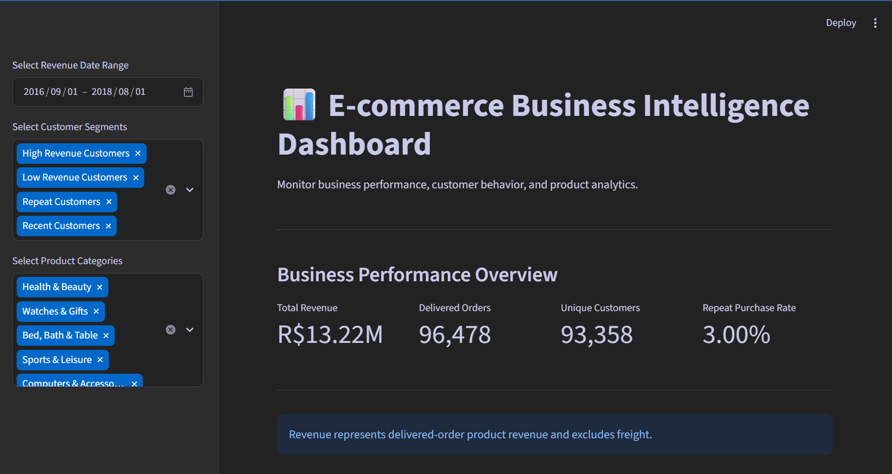
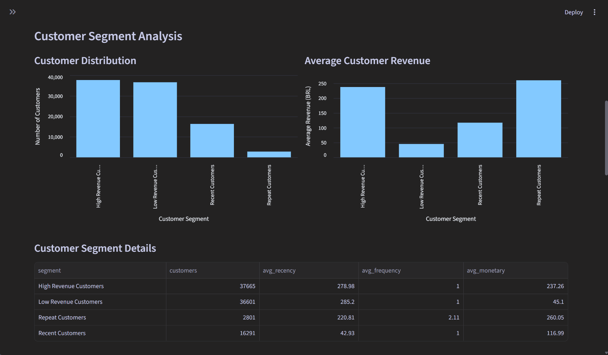
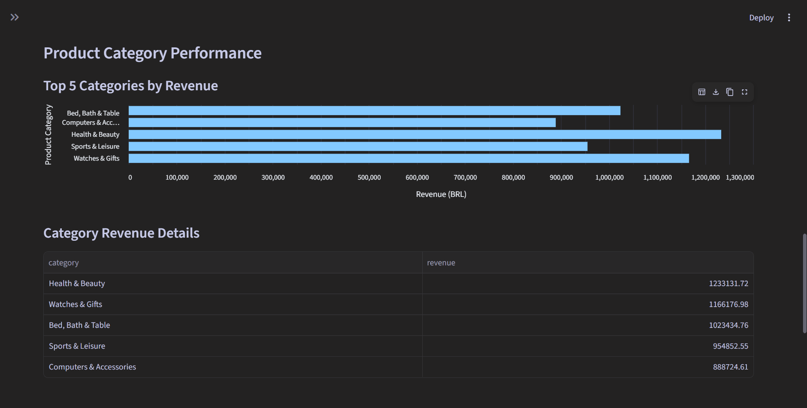
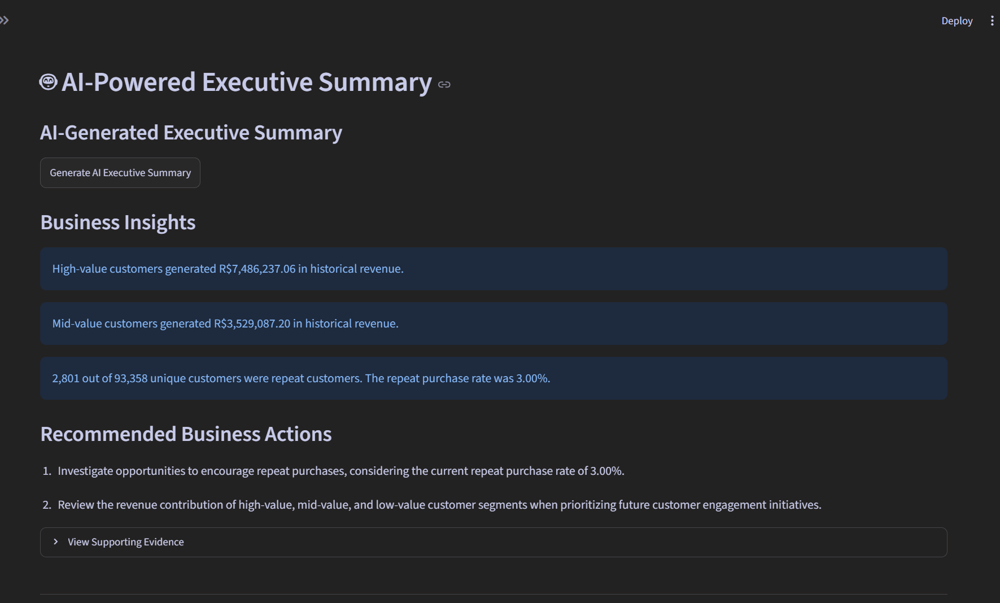

# AI-Powered Business Intelligence & Analytics

An end-to-end e-commerce analytics platform designed to analyze business performance, understand customer purchasing behavior, identify trends, segment customers, and generate AI-powered business recommendations.

## Project Overview

This project uses real-world e-commerce transaction data from the Brazilian Olist marketplace to develop an interactive business intelligence and analytics solution.

The platform combines data cleaning, exploratory data analysis, SQL analytics, statistical techniques, machine learning, data visualization, and large language models to transform raw transactional data into actionable business insights.

The project focuses on understanding sales performance, customer behavior, retention patterns, product performance, and opportunities for business growth.

## Project Objectives

- Analyze revenue and sales performance.
- Identify top-performing products and categories.
- Measure customer retention and repeat purchases.
- Develop RFM-based customer segments.
- Identify high-value and at-risk customers.
- Analyze purchasing behavior and payment methods.
- Explore relationships between order value and freight costs.
- Apply machine learning for customer clustering.
- Build interactive business intelligence dashboards.
- Generate evidence-based business recommendations using an LLM.

## Technology Stack

| Category | Technologies |
|---|---|
| Programming | Python |
| Data Analysis | Pandas, NumPy |
| Database | PostgreSQL |
| Query Language | SQL |
| Data Visualization | Matplotlib, Seaborn |
| Machine Learning | Scikit-learn, K-Means, Joblib |
| Dashboard | Tableau / Power BI, Streamlit |
| AI Integration | Ollama, Qwen 3.5 (0.8B) |
| Development | VS Code, Jupyter Notebook |
| Version Control | Git, GitHub |

## Dataset

**Brazilian E-Commerce Public Dataset by Olist**

Source: [Kaggle - Brazilian E-Commerce Public Dataset](https://www.kaggle.com/datasets/olistbr/brazilian-ecommerce)

The dataset contains approximately 100,000 orders from the Brazilian Olist marketplace and includes information about:

- Customers
- Orders
- Order items
- Payments
- Reviews
- Products
- Sellers
- Geolocation
- Product category translations

The original dataset contains nine CSV files.

Download and extract the dataset into `data/raw/`.

The dataset is not included in this repository.

## Project Structure

```text
ai-powered-business-intelligence/
│
├── data/
│   ├── raw/
│   └── processed/
│
├── notebooks/
│   └── eda.ipynb
│
├── src/
│   ├── load_data.py
│   ├── clean_data.py
│   ├── inspect_missing.py
│   ├── refine_cleaning.py
│   ├── update_database.py
│   ├── prepare_customer_features.py
│   ├── scale_customer_features.py
│   ├── evaluate_clusters.py
│   ├── customer_clustering.py
│   ├── test_ollama.py
│   └── generate_insights.py
│
├── sql/
│   ├── 01_data_quality.sql
│   ├── 02_revenue_analysis.sql
│   ├── 03_product_analysis.sql
│   ├── 04_customer_analysis.sql
│   └── 05_business_analytics.sql
│
├── models/
│   └── kmeans_customer_segments.joblib
│
├── dashboard/
├── docs/
│   └── ai_insights_sample.json
│
├── requirements.txt
├── .env.example
├── .gitignore
└── README.md
```

## Setup Instructions

### 1. Clone the repository

```bash
git clone https://github.com/alisharawat56/ai-powered-business-intelligence.git

cd ai-powered-business-intelligence
```

### 2. Create a virtual environment

```bash
python -m venv .venv
```

Activate it:

**Windows PowerShell:**

```powershell
.venv\Scripts\Activate.ps1
```

### 3. Install dependencies

```bash
pip install -r requirements.txt
```

### 4. Download the dataset

Download the Olist dataset from Kaggle and extract the CSV files into:

```text
data/raw/
```

### 5. Configure PostgreSQL

Create a PostgreSQL database named:

```text
ecommerce_analytics
```

Create a local `.env` file using `.env.example` as a template.

Configure the following environment variables:

```text
DB_USER=postgres
DB_PASSWORD=your_password
DB_HOST=localhost
DB_PORT=5432
DB_NAME=ecommerce_analytics
```

Do not commit `.env` or database credentials to GitHub.

### 6. Load the data

```bash
python src/load_data.py
```

### 7. Run data cleaning and database update scripts

```bash
python src/clean_data.py
python src/inspect_missing.py
python src/refine_cleaning.py
python src/update_database.py
```

### 8. Set up Ollama

Install Ollama and download the Qwen model:

```bash
ollama pull qwen3.5:0.8b
```

Make sure the Ollama service is running before executing the AI insights script.

## Project Progress

### Phase 1: Data Loading and Database Setup — Completed

- Downloaded the Brazilian Olist e-commerce dataset.
- Organized the raw and processed data directories.
- Created a PostgreSQL database.
- Loaded the original datasets into PostgreSQL using Python and SQLAlchemy.

### Phase 2: Data Cleaning and Preparation — Completed

Used Python, Pandas, and NumPy to:

- Inspect missing values and duplicate records.
- Validate data types and numerical fields.
- Convert timestamp fields and prepare data for analysis.
- Investigate missing delivery timestamps.
- Identify missing product categories.
- Preserve optional review comments rather than filling them with arbitrary values.
- Handle missing product categories by assigning an `unknown` category.
- Prepare cleaned datasets for PostgreSQL analysis.

Seven datasets were cleaned and loaded into PostgreSQL:

- Customers
- Orders
- Order items
- Payments
- Reviews
- Products
- Sellers

### Phase 3: Exploratory Data Analysis — Completed

Created an exploratory data analysis notebook using Pandas, Matplotlib, and Seaborn.

The notebook includes:

- Dataset overview and structural inspection.
- Missing-value analysis and visualizations.
- Duplicate record checks.
- Product category revenue analysis.
- Monthly revenue trends.
- Customer purchase behavior.
- Repeat purchase analysis.
- Customer revenue segmentation.
- Payment method analysis.
- Customer review score analysis.
- Key business findings.

### Phase 4: SQL Business Analytics — Completed

Used PostgreSQL and SQL to perform business-focused analysis.

**Revenue and Product Analysis**

- Revenue by product category.
- Identification of top-performing product categories.
- Monthly revenue trends.
- Month-over-month revenue analysis.
- Weekly order and revenue trends.
- Average order value analysis.

**Customer Analytics**

- Customer purchase history.
- Identification of top revenue-generating customers.
- Repeat purchase rate calculation.
- Customer revenue segmentation using `NTILE()`.
- Payment method analysis.
- Revenue outlier identification using standard deviation thresholds.

**Retention and Cohort Analysis**

- Identification of customer acquisition cohorts.
- Monthly cohort retention analysis.
- Calculation of customer activity across purchase months.
- Analysis of repeat purchasing behavior.

**RFM Customer Segmentation**

Implemented Recency, Frequency, and Monetary analysis to understand customer purchasing behavior.

Customers were scored using five groups for each RFM dimension and classified into six segments:

- Champions
- Loyal Customers
- Potential Loyalists
- At Risk
- Hibernating
- Needs Attention

**Order Value and Freight Analysis**

- Grouped delivered orders by product value.
- Calculated average order value and freight charges.
- Analyzed freight as a percentage of product value.
- Investigated how shipping costs vary across order-value ranges.

### Phase 5: Machine Learning — Customer Segmentation with K-Means — Completed

Applied Scikit-learn to perform unsupervised customer segmentation using Recency, Frequency, and Monetary features.

**Feature Engineering and Scaling**

- Prepared customer-level RFM features using Python and SQL-derived metrics.
- Examined feature distributions and skewness.
- Applied logarithmic transformation using `log1p()`.
- Standardized features using `StandardScaler`.

**Cluster Evaluation**

Evaluated K-Means clustering solutions for K values ranging from 2 to 8.

- Used the Elbow Method to examine cluster inertia.
- Used silhouette scores to evaluate cluster separation.
- Selected four clusters as a business-oriented compromise between cluster separation and interpretability.

The silhouette score for four clusters was approximately 0.3926, calculated using a sample of 5,000 customers.

**Cluster Interpretation**

Four customer groups were identified:

| Cluster | Customers | Average Recency (Days) | Average Frequency | Average Monetary (R$) |
|---|---:|---:|---:|---:|
| 0 | 37,665 | 278.98 | 1.00 | 237.26 |
| 1 | 36,601 | 285.20 | 1.00 | 45.10 |
| 2 | 2,801 | 220.81 | 2.11 | 260.05 |
| 3 | 16,291 | 42.93 | 1.00 | 116.99 |

Business interpretations:

- **Cluster 0:** Higher-spending, mostly one-time customers with less recent purchases.
- **Cluster 1:** Lower-spending, mostly one-time customers with less recent purchases.
- **Cluster 2:** Repeat purchasers with the highest average frequency and monetary value.
- **Cluster 3:** Recently active customers with mostly one-time purchases.

**Comparison with RFM Segmentation**

Compared K-Means clusters against rule-based RFM segments using:

- Adjusted Rand Index (ARI): 0.2606
- Normalized Mutual Information (NMI): 0.3615

These results indicate some agreement between the two segmentation approaches, but not strong equivalence.

The comparison highlights that rule-based RFM segmentation and unsupervised clustering capture different aspects of customer behavior.

**Model Persistence**

Saved the trained K-Means model using Joblib:

```text
models/kmeans_customer_segments.joblib
```

The clusters are exploratory groups, not ground-truth customer labels or predictions of future behavior.

### Phase 6: AI-Powered Business Insights with Ollama — Completed

Implemented a local LLM-powered business insights feature using **Ollama** and the Qwen 3.5 (0.8B) model.

**Features**

- Uses verified business KPIs calculated through Python and SQL.
- Generates factual business observations directly in Python.
- Uses the local LLM to generate business recommendations.
- Returns structured JSON containing three business insights and two recommendations.
- Includes basic validation to reject missing fields and selected unsupported claims.

**Key Business Metrics Used**

- High-value customer revenue: R$7,486,237.06
- Mid-value customer revenue: R$3,529,087.20
- Low-value customer revenue: R$2,206,173.85
- Unique customers: 93,358
- Repeat customers: 2,801
- Repeat purchase rate: 3.00%

**Implementation**

- `src/generate_insights.py` – Generates and validates business insights.
- `src/test_ollama.py` – Tests the local Ollama integration.
- `docs/ai_insights_sample.json` – Example structured AI insights output.

**Important:** AI-generated recommendations are suggestions, not verified business findings. Factual observations are generated from calculated KPIs to reduce the risk of LLM hallucinations. Basic validation does not guarantee that every generated recommendation is factually correct.

### Phase 7: Interactive Business Intelligence Dashboard

Built an interactive dashboard using **Streamlit** to present key e-commerce business insights in an accessible, executive-friendly format.

**Dashboard Features**

- **KPI Overview:** Displays total revenue, delivered orders, unique customers, and repeat purchase rate.
- **Monthly Revenue Trends:** Visualizes monthly revenue performance over time.
- **Customer Segmentation:** Presents customer groups identified using K-Means clustering, with business-friendly segment labels.
- **Product Category Analysis:** Highlights the top-performing product categories by revenue.
- **Interactive Filters:** Allows users to filter dashboard views by date range, customer segment, and product category.
- **AI-Powered Executive Summary:** Integrates a locally running Ollama language model (`qwen3.5:0.8b`) to generate business summaries from verified metrics.
- **Business Question Interface:** Allows users to ask supported business questions and receive data-backed responses.

**Technologies Used**

- Python
- Streamlit
- Pandas and NumPy
- PostgreSQL and SQL
- Scikit-learn
- Ollama (Qwen 3.5 0.8B)

**Running the Dashboard**

Activate the project virtual environment and run:

```bash
streamlit run dashboard/app.py
```

The dashboard uses historical e-commerce data covering September 2016 through August 2018.

**Note:** The Ollama-generated executive summary is experimental. Its output should be reviewed against the underlying business metrics before making business decisions. The business question interface currently supports a limited set of questions.

### AI-Powered Business Insights

The project includes an AI-assisted business intelligence layer that converts calculated business metrics into structured business insights.

**Implemented features:**
- Generates executive-style insights using calculated customer and revenue KPIs.
- Includes supporting metrics and separates measured facts from possible explanations.
- Produces business recommendations based on customer-segment performance and repeat purchase behavior.
- Answers a business question about monthly revenue decline using historical monthly revenue data.
- Returns structured JSON containing insights, recommendations, supporting metrics, and limitations.

**Business question example:**

"Why did revenue decline this month?"

The system compares the latest two available months and calculates the revenue change and percentage change. It distinguishes the measured decline from its possible causes, rather than claiming an unsupported explanation.

**LLM integration:**

Ollama was installed and tested locally using the Qwen 3.5 0.8B model. The current production insight-generation and business-question logic uses Python-based calculations and rules to prioritize numerical accuracy and avoid unsupported LLM-generated claims.

**Output:** `docs/ai_insights_sample.json`
**Main implementation:** `src/generate_insights.py`

## Key Business Findings

### Sales and Product Performance

- Health & Beauty was the highest-revenue product category, generating approximately R$1.23 million in product revenue.
- Watches & Gifts generated approximately R$1.17 million.
- Bed, Bath & Table generated approximately R$1.02 million.
- Revenue and order volumes increased substantially during the marketplace's growth period.

### Customer Behavior

- Approximately 93,358 unique customers made delivered purchases.
- Approximately 2,801 customers made repeat purchases.
- The repeat purchase rate was approximately 3%.
- High-value customers contributed approximately 57% of customer revenue.

### Payment Analysis

- Credit cards were the dominant payment method.
- Credit card transactions accounted for approximately R$12.10 million in payment value among delivered orders.
- Voucher payments had a substantially lower average payment-record value than credit card payments.

### Customer Segmentation

RFM analysis identified six customer segments.

Key findings:

- At-Risk customers: 22,026 customers with approximately R$4.70 million in historical revenue.
- Champions: 15,108 customers with approximately R$4.14 million in historical revenue.
- Champions had the highest average historical customer revenue at approximately R$274.06.
- At-Risk customers had an average recency of approximately 394 days.
- Champions had an average recency of approximately 92 days.

These findings highlight opportunities for customer retention, re-engagement, and loyalty initiatives.

### Order Value and Freight Analysis

The analysis revealed that freight costs represented a larger percentage of product value for lower-value orders.

- Orders below R$50 had an average freight-to-product-value ratio of approximately 48.38%.
- Orders above R$500 had an average ratio of approximately 6.19%.
- Approximately 88.3% of analyzed delivered orders fell into the three lowest order-value groups.

This suggests opportunities to investigate free-shipping thresholds and product bundling strategies.

### Dataset Limitations

- The Olist dataset does not contain an explicit discount amount or discount percentage field.
- Voucher payments cannot be treated as direct evidence of discounts.
- RFM segmentation is based on historical purchasing behavior and does not predict future churn.
- Historical customer revenue should not be interpreted as predictive customer lifetime value.
- K-Means clusters are exploratory segments and should not be treated as ground-truth customer classifications.
- The LLM can generate unsupported recommendations, so its output requires review.

## SQL Concepts Applied

- Common Table Expressions (CTEs)
- Joins and aggregations
- Window functions
- `ROW_NUMBER()` and `RANK()`
- `NTILE()` for customer scoring and segmentation
- `DATE_TRUNC()` for time-based analysis
- Cohort analysis
- Conditional aggregation
- Statistical outlier detection
- Revenue and retention metrics

## Methodology and Business Assumptions

### 1. Data Preparation
- Used the Brazilian E-Commerce Public Dataset by Olist.
- Loaded and inspected raw CSV files using Python, Pandas, and NumPy.
- Performed data cleaning, missing-value inspection, and data quality checks.
- Loaded the processed data into PostgreSQL for structured analysis.

### 2. SQL Business Analytics
- Used PostgreSQL queries to analyze revenue, orders, products, and customer behavior.
- Defined revenue as the sum of product item prices for delivered orders.
- Excluded freight charges from the revenue calculation.
- Analyzed monthly revenue trends and product category performance.

### 3. Customer Segmentation
- Prepared customer-level Recency, Frequency, and Monetary (RFM) features.
- Applied log transformation and feature scaling.
- Used K-Means clustering to identify four customer segments.
- Interpreted clusters using business-friendly labels based on their characteristics.

### 4. AI-Powered Business Insights
- Used Python-based business rules to generate evidence-based insights and recommendations.
- Integrated a locally running Ollama language model to generate natural-language executive summaries.
- Supplied verified business metrics as context rather than exposing raw customer records.

### 5. Dashboard
- Developed an interactive Streamlit dashboard.
- Included KPI cards, monthly revenue trends, customer segmentation, and product category analysis.
- Added filters for date ranges, customer segments, and product categories.

### Business Assumptions
- Revenue represents product sales value and excludes freight.
- Revenue analysis focuses on delivered orders.
- Repeat customers are customers with more than one order.
- Customer segments represent patterns in the available historical dataset, not permanent customer identities.
- The latest available transaction period is August 2018.
- Historical trends do not necessarily predict future performance.

## AI Limitations, Reliability, and Responsible Use

### 1. Language Model Limitations
- The project uses a locally hosted Qwen 3.5 0.8B model through Ollama.
- The relatively small model may produce incomplete, repetitive, or inaccurate explanations.
- Generated summaries may vary between runs.
- The model does not independently verify the underlying database or business calculations.

### 2. Hallucination Risks
Generative AI may:
- Produce incorrect numerical interpretations.
- Invent explanations for revenue changes.
- Recommend actions that are not supported by available evidence.
- Misinterpret historical trends or customer behavior.

### 3. Safeguards
To reduce these risks:
- Business metrics are calculated using Python and SQL rather than generated by the language model.
- Verified metrics are supplied to the model as context.
- Prompts explicitly instruct the model not to invent figures or claim unsupported causes.
- AI-generated recommendations should be reviewed before business decisions are made.
- Generated summaries are treated as decision-support material, not as verified business facts.

### 4. Current Limitations
- The dataset contains historical transactions ending in August 2018.
- The analysis does not establish causal relationships between customer behavior and revenue changes.
- Customer segmentation depends on the selected features, scaling method, and K-Means configuration.
- The model is not connected to a continuously updated production database.

### 5. Future Improvements
- Evaluate generated summaries against a structured set of test questions.
- Add automated validation of numerical claims.
- Compare outputs across different language models.
- Introduce monitoring for hallucinations and unsupported recommendations.
- Integrate more recent e-commerce data.

## Dashboard Preview

### Executive Dashboard


### Customer Segmentation


### Product Category Performance


### AI-Generated Executive Insights



## Project Walkthrough

### End-to-End Workflow

The project follows this analytical workflow:

1. **Data ingestion:** Import the Olist e-commerce dataset using Python.
2. **Data cleaning:** Inspect missing values, clean records, and prepare datasets using Pandas and NumPy.
3. **Database management:** Store structured data in PostgreSQL.
4. **Business analytics:** Use SQL to analyze revenue, products, orders, and customer behavior.
5. **Customer segmentation:** Apply RFM analysis and K-Means clustering to identify customer groups.
6. **AI-powered insights:** Generate business insights using Python and natural-language executive summaries using Ollama.
7. **Visualization:** Present analytical results through an interactive Streamlit dashboard.

### Technologies Used

| Technology | Purpose |
|---|---|
| Python | Data processing and analytics |
| Pandas and NumPy | Data cleaning and manipulation |
| PostgreSQL | Relational data storage and SQL analytics |
| Scikit-learn | Customer segmentation |
| Ollama | Local language model integration |
| Streamlit | Interactive dashboard |
| Git and GitHub | Version control and project presentation |

### Running the Dashboard Locally

1. Clone the repository.
2. Create and activate a Python virtual environment.
3. Install the project dependencies.
4. Configure the PostgreSQL connection using the provided environment-variable template.
5. Run the dashboard.

```bash
git clone https://github.com/alisharawat56/ai-powered-business-intelligence.git

cd ai-powered-business-intelligence

python -m venv .venv
```

Activate the environment on Windows PowerShell:

```powershell
.venv\Scripts\Activate.ps1
```

Install dependencies and launch:

```bash
pip install -r requirements.txt

streamlit run dashboard/app.py
```

**Note:** PostgreSQL and Ollama must also be configured and running for the corresponding database and live AI features.


## Author

**Alisha Rawat**

Master's Student in Information Management  
University of Illinois Urbana-Champaign

GitHub: [alisharawat56](https://github.com/alisharawat56)
